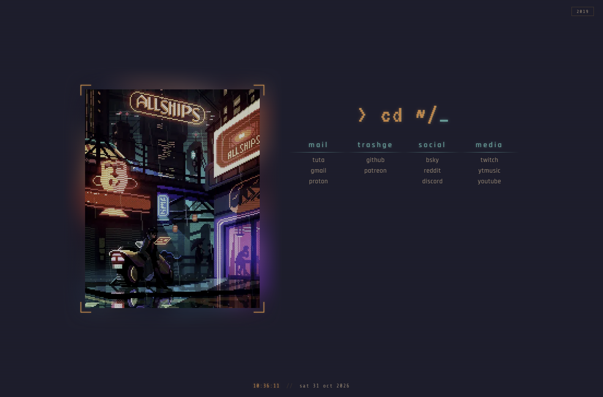
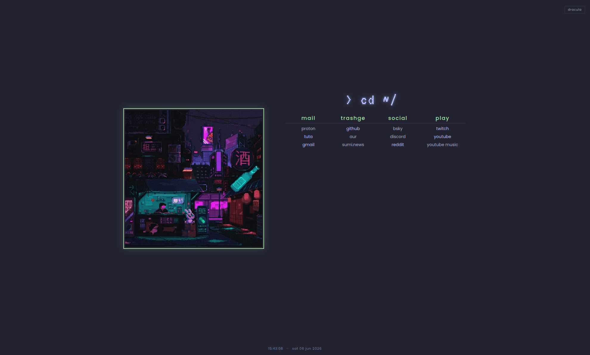
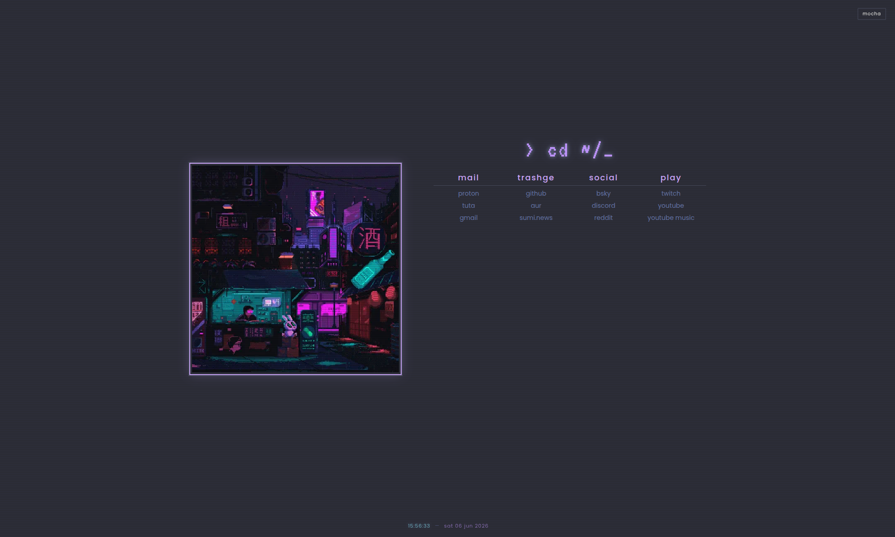

# ~/startpage

A minimal browser startpage with a Blade Runner / cyberpunk terminal aesthetic.



## Features

- Categorized bookmarks
- Live clock with date, fixed at bottom-center
- Neon `> cd ~/_` heading with a slight RGB split, an occasional flicker and a blinking cursor
- Custom `> _` favicon in cyan and magenta
- Theme switcher: cycles between **2019** (default) and **2049**, remembered across sessions
- Animated pixel-art image with scanlines, a soft duotone tint to match the active theme and HUD-style corner brackets
- Ambient glow behind the image: a blurred copy of the animation bleeds out around the frame, so the glow changes color as the scene moves
- Small `tyrell terminal 07` tag in the top-left corner
- Muted accent colors and soft glows, so nothing is harsh on the eyes
- Responsive: below 1250px wide the image stacks above the links
- Respects `prefers-reduced-motion` (the flicker and cursor blink are switched off)

## Themes

| Theme | Class | Background | Accent | Secondary | Description |
|---|---|---|---|---|---|
| 2019 | `rain` | `#282a36` | `#5fb4c4` teal | `#b8567e` rose | Default. Cyan and magenta neon on a dark purple-blue base |
| 2049 | `haze` | `#1e1e2e` | `#c98245` amber | `#4f9d96` sage | Sodium-orange glow with a teal pop |

The toggle button in the top-right shows the theme you will switch to. The choice is saved with `localStorage`.

## Fonts

- [Rajdhani](https://fonts.google.com/specimen/Rajdhani): links and category titles
- [Share Tech Mono](https://fonts.google.com/specimen/Share+Tech+Mono): clock, date, theme button and corner tag
- [VT323](https://fonts.google.com/specimen/VT323): heading only, for the retro terminal look

All loaded via Google Fonts, no install needed.

## Usage

Clone or download the repo, then open `index.html` in your browser. Set it as your browser's homepage or use an extension like [New Tab Redirect](https://chromewebstore.google.com/detail/new-tab-redirect/icpgjfneehieebagbmdbhnlpiopdcmna).

```
git clone https://github.com/yourusername/startpage
```

File structure:

```
startpage/
├── index.html
├── style.css
└── cyber002.webp   ← swap this for any image you like
```

### Changing the image

The image is used in two places, so update both:

1. `index.html`, the visible image:

```html

```

2. `style.css`, the blurred glow behind it (`.left-container::after`):

```css
background: url("your-image.webp") center / cover no-repeat;
```

The frame is set to a 460×575 portrait ratio. If your image has a different shape, change `width`/`height` on `.left-container` and `.gif img`, and the `aspect-ratio` value in the narrow-screen media query at the bottom of `style.css`.

An animated webp works well here, but file size adds up. The bundled one is resized to the display size and compressed to about 2 MB. Resizing to the size it is shown at and lowering the quality is the easiest way to shrink a larger file.

## Customization

Edit bookmark links directly in `index.html`. To add a new category, copy an existing `.category` block and update the title and links.

**Colors.** Each theme is a block of CSS variables at the top of `style.css`:

```css
body.rain {
  --bg: #282a36;      /* page background */
  --fg: #b8c4d4;      /* body text */
  --link: #7f8ca3;    /* link color */
  --accent: #5fb4c4;  /* heading, hover, brackets, clock */
  --accent2: #b8567e; /* category titles, cursor */
  --dim: #3b4259;     /* muted details */
}
```

**Adding a theme.** Add a new `body.yourtheme { ... }` block with the same variables, then add it to the `themes` array and the `labels` object in the script at the bottom of `index.html`.

**Glow strength.** In the `.left-container::after` rule in `style.css`, `opacity` controls how strong the glow is, and `blur()` together with `inset` controls how far it spreads. The mask in the same rule fades the glow's edges so it never shows a hard box line.

<details>
<summary>OLD Design</summary>

The original version: a minimal terminal / 90s CRT look with Dracula and Catppuccin Mocha themes.




### Features

- Categorized bookmarks
- Live clock with date, fixed at bottom-center
- Blinking cursor animation
- Custom `> _` favicon
- Theme switcher: cycles between **Dracula** (default) and **Catppuccin Mocha** with a random accent color on every switch
- CRT scanline effect on image and page background
- Phosphor glow on heading and links
- Pixel-style border around image, accent-colored per theme

### Themes

| Theme | Description |
|---|---|
| [Dracula](https://draculatheme.com) | Default. Dark purple palette |
| [Catppuccin Mocha](https://github.com/catppuccin/catppuccin) | Picks a random accent on every switch: rosewater, flamingo, pink, mauve, red, maroon, peach, yellow, green, teal, sky, sapphire, blue, or lavender |

Theme preference is saved across sessions via `localStorage`.

### Fonts

- [Poppins](https://fonts.google.com/specimen/Poppins): everything readable: links, clock, category titles
- [VT323](https://fonts.google.com/specimen/VT323): heading only, for the retro terminal look

### Files

```
startpage/
├── index.html
├── style.css
└── cat.webp
```

### Customization

The Mocha accent colors were set in the `mochaAccents` array in the script at the bottom of `index.html`:

```js
const mochaAccents = [
    { name: 'mauve', hex: '#cba6f7' },
    { name: 'blue',  hex: '#89b4fa' },
    // add or remove entries here
];
```

### Credits

[Cat artwork by Avogado6](https://x.com/avogado6/status/1165595520967954432)

</details>

## Credits

[Gif artwork by alphacoders.com](https://gifs.alphacoders.com/gifs/view/215468)

[Startpage inspired by kencx](https://github.com/kencx/startpage)
