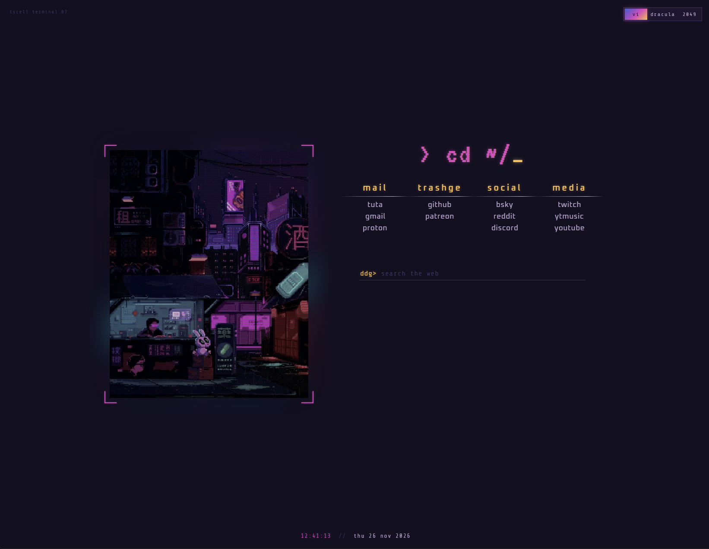

# ~/startpage

**Browser startpage:** a dark cyberpunk terminal startpage with three themes.



## Features

- Categorized bookmarks
- Live clock with date, fixed at bottom-center
- Neon `> cd ~/_` heading with a slight RGB split, an occasional flicker and a blinking cursor
- Custom `> _` favicon in cyan and pink
- Theme switch: a three-stop pill (**vi**, **2019**, **dracula**) in the top-right. The knob slides to the chosen theme and all colors fade over instead of snapping. Your choice is saved with `localStorage`
- Magnetic links: a bookmark leans toward the cursor when you get close and springs back when you leave
- Cursor dot grid: a soft patch of dots appears around the mouse in the theme's accent color and ripples away from it
- Animated pixel-art image with scanlines, a soft gradient tint to match the active theme and HUD-style corner brackets
- Ambient glow behind the image: a blurred copy of the animation bleeds out around the frame, so the glow changes color as the scene moves
- Small `tyrell terminal 07` tag in the top-left corner
- Responsive: below 1250px wide the image stacks above the links
- Respects `prefers-reduced-motion` (flicker, cursor blink, magnetic links and the moving dot grid are switched off)

## Themes

Dark mode only.

| Theme | Class | Background | Accent | Secondary | Description |
|---|---|---|---|---|---|
| vi | `vice` | `#141022` | `#e13fbd` pink | `#ffbc53` orange | Default. GTA VI style blue, pink and orange sunset |
| 2019 | `rain` | `#282a36` | `#5fb4c4` teal | `#b8567e` rose | Cyan and magenta neon on a dark purple-blue base |
| dracula | `dracula` | `#282a36` | `#ff79c6` pink | `#bd93f9` purple | The [Dracula](https://draculatheme.com) color scheme |

## Fonts

- [Oxanium](https://fonts.google.com/specimen/Oxanium): links and category titles
- [Share Tech Mono](https://fonts.google.com/specimen/Share+Tech+Mono): clock, date, theme switch and corner tag
- [VT323](https://fonts.google.com/specimen/VT323): heading only, for the retro terminal look

All loaded via Google Fonts, no install needed.

## Usage

Clone or download the repo, then open `index.html` in your browser. Set it as your browser's homepage or use an extension like [New Tab Redirect](https://chromewebstore.google.com/detail/new-tab-redirect/icpgjfneehieebagbmdbhnlpiopdcmna).

```
git clone https://github.com/OD728/startge
```

File structure:

```
startge/
├── index.html
├── style.css
└── cyber002.webp   ← swap this for any image you like
```

### Changing the image

The image is used in two places, so update both:

1. `index.html`, the visible image:

```html

```

2. `style.css`, the blurred glow behind it (`.left-container::after`):

```css
background: url("your-image.webp") center / cover no-repeat;
```

The frame is set to a 460×575 portrait ratio. If your image has a different shape, change `width`/`height` on `.left-container` and `.gif img`, and the `aspect-ratio` value in the narrow-screen media query in `style.css`.

## Customization

Edit bookmark links directly in `index.html`. To add a new category, copy an existing `.category` block and update the title and links.

**Colors.** Each theme is a block of CSS variables in `style.css`:

```css
body.vice {
  --bg: #141022;      /* page background */
  --fg: #f3e6f1;      /* body text */
  --link: #b7a2cc;    /* link color, grid dots */
  --accent: #e13fbd;  /* heading, hover, brackets, clock, dot glow */
  --accent2: #ffbc53; /* category titles, cursor */
  --dim: #3f3260;     /* muted details */
}
```

**Adding a theme.** Add a `body.yourtheme { ... }` block with the same variables, add its name to the `themes` array in the script at the bottom of `index.html`, add a `<button role="radio" data-theme="yourtheme">` to the `.switch`, and widen the switch (`grid-template-columns` in `.switch`, plus a `translateX` rule for the new knob position).

**Dot grid.** In the `grid()` function in `index.html`, `gap` is the space between dots and `reach` is how far around the cursor they show.

## Credits

[Gif artwork by alphacoders.com](https://gifs.alphacoders.com/gifs/view/215468)

[Startpage inspired by kencx](https://github.com/kencx/startpage)

Theme switch and magnetic links inspired by demos in [Takagi-Dev-content/Contents-Code](https://github.com/Takagi-Dev-content/Contents-Code) (rewritten from scratch).
